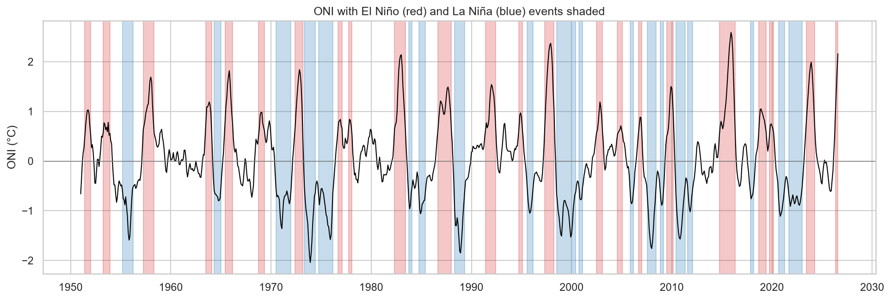
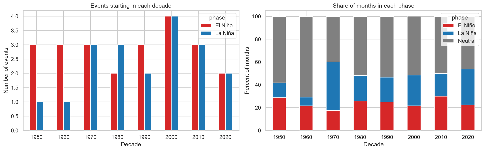
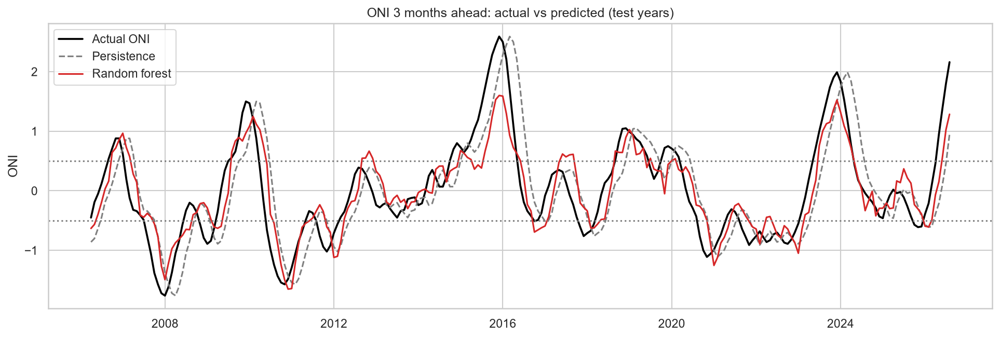

# El Niño / La Niña Analysis, 1951 to 2026

A data cleaning, exploratory analysis and forecasting project built on two NOAA climate indices: the Oceanic Niño Index (ONI) and the Southern Oscillation Index (SOI). I took two raw, messy text files, cleaned and merged them, explored 75 years of El Niño and La Niña events, and tested whether the ONI can be forecast 1 to 6 months ahead.



## Questions

1. How often do El Niño and La Niña happen, how long do they last, and how strong do they get?
2. Which were the strongest events?
3. Has the number of events changed by decade, and when do events peak?
4. How closely do the ONI and SOI agree, and does one lead the other?
5. Can past ONI and SOI values predict the ONI 1, 2, 3 and 6 months ahead better than a simple guess?

## Key findings

- **Time in each phase.** Of 908 months (Jan 1951 to Aug 2026), about 24% were El Niño (219 months), 23% La Niña (208) and 53% Neutral (481).
- **Events.** There were 23 El Niño and 19 La Niña events. Both lasted a median of 9 months. La Niña ran slightly longer on average (10.9 vs 9.8 months) and produced the longest event (24 months, vs 20).
- **Strength.** Very strong events (peak ONI of 2.0 or more) were much more common for El Niño (4) than La Niña (1). The strongest El Niños were 2014-16 (+2.59), 1997-98 (+2.37) and 1982-83 (+2.14). The strongest La Niñas were 1973-74 (-2.04), 1988-89 (-1.85) and 2007-08 (-1.76).
- **Current event.** The ongoing 2026 El Niño (ONI +2.16 in the latest data) is already the third strongest on record after only four months, and is still developing.
- **Timing.** Almost all events peak between November and January, with December the most common month for both phases. No event peaked between March and July.
- **By decade.** Each decade had 2 to 4 events of each type, so there is no clear change in frequency. The 1960s were the calmest decade (71% Neutral months) and the 1970s the most active (42.5% of months in La Niña).
- **ONI vs SOI.** The two indices are strongly negatively correlated (r = -0.73). Smoothing the SOI with a 3-month average, the way the ONI is built, raises this to -0.84. The correlation is strongest at lag 0 and falls off symmetrically, so neither index clearly leads the other.
- **Long-term change.** Average Niño 3.4 temperature rose about 0.06 °C per decade, small compared with year-to-year swings of up to about 1 °C. This is an observation, not proof of a cause.



## Forecasting experiment

I tested whether past ONI and SOI values (up to 6 months back, plus the month of the year) can predict the ONI 1, 2, 3 and 6 months ahead. I trained on 1951 to 2005 and tested on 2006 to 2026, using a time-based split with no random shuffling, so no future data leaked into training. I compared linear regression and a random forest with two baselines: persistence (the future looks like now) and the training mean.

- **Models:** Linear Regression and Random Forest
- **Baselines:** Persistence and training mean
- **Features:** ONI and SOI from 0, 1, 2, 3 and 6 months back, plus the month of the year
- **Split:** train 1951 to 2005, test 2006 to 2026 (time-based)
- **Forecast horizons:** 1, 2, 3 and 6 months ahead
- **Metrics:** MAE (average error in ONI units) and phase accuracy

Average error (MAE, in ONI units, lower is better):

| Months ahead | Persistence | Linear regression | Random forest |
|---|---|---|---|
| 1 | 0.171 | 0.078 | 0.123 |
| 2 | 0.327 | 0.187 | 0.230 |
| 3 | 0.466 | 0.309 | 0.337 |
| 6 | 0.764 | 0.563 | 0.564 |

- Both models beat persistence at every horizon. Linear regression had 54%, 43%, 34% and 26% lower error at 1, 2, 3 and 6 months. The random forest had 28%, 30%, 28% and 26%.
- Linear regression was the best model at 1 to 3 months, and the two models tied at 6 months. With only about 650 training months, the simpler model won.
- Part of the short-range skill is momentum: the lagged values show which way the ONI is moving, while persistence assumes it stands still.
- Skill fades with distance. At 6 months the models' error is only about 17% below a guess that ignores current conditions (the training mean, MAE 0.68).
- The predicted phase (El Niño, La Niña or Neutral) was right 96% of the time at 1 month with linear regression, 75% at 3 months and 53% at 6 months.
- **Where it fails.** Errors were largest for forecasts made in February to April, which fits the known spring predictability barrier. The ten largest random forest misses came from two episodes: the rapid growth of the 2015-16 El Niño (the model predicted far too low) and a sudden flip from El Niño to La Niña in early 2010.
- **What it relied on.** The random forest depended mostly on the latest ONI value (about 73% of importance). SOI added little, which matches the lag analysis.



## Cleaning highlights

- **ONI:** converted the 3-month season codes (DJF, JFM, ...) into the middle month and built a proper date column, then checked for duplicates and missing months (none).
- **SOI:** the file held header text, two blocks of data (anomaly and standardized), numbers running together with no spaces (like `-3.3-999.9`), and a missing-value code (`-999.9`). I read it by fixed column width, kept the anomaly block, converted 51 missing-code cells to NaN, and reshaped it from wide to long format.
- **Merge:** inner join on date, giving 908 monthly rows from January 1951 to August 2026.
- **Phase labels:** a month is El Niño or La Niña when the ONI stays beyond ±0.5 for at least 5 consecutive months, a simplified version of NOAA's rule. I found that the ongoing 2026 event was being hidden as Neutral because it had not yet reached 5 months, so I label an unfinished event at the end of the data by its current state and document this choice.

## Data

- **ONI** (Oceanic Niño Index, 3-month running mean of Niño 3.4 sea surface temperature anomalies): NOAA Climate Prediction Center, https://www.cpc.ncep.noaa.gov/data/indices/oni.ascii.txt
- **SOI** (Southern Oscillation Index, Tahiti minus Darwin sea level pressure anomaly): NOAA Climate Prediction Center, https://www.cpc.ncep.noaa.gov/data/indices/soi

Data downloaded 31 October 2026. NOAA updates these files monthly, so rerunning with newer files will change the latest values.

## Data dictionary (`data/enso_clean.csv`)

| Column | Meaning |
|---|---|
| date | First day of the month |
| SEAS | 3-month season code from the ONI (for example DJF), centered on the month in `date` |
| oni | ONI anomaly in °C. Positive means warmer than normal (El Niño side) |
| nino34_sst | Niño 3.4 sea surface temperature in °C (includes the normal seasonal cycle) |
| soi | SOI anomaly for the month. Negative means El Niño side, positive means La Niña side |
| phase_simple | Label from that month's ONI alone (+0.5 or more, -0.5 or less, or Neutral) |
| phase | Label using the 5-consecutive-month rule, plus the ongoing-event rule |

## Project structure

```
elnino-project/
  data/        raw files (oni.ascii.txt, soi_raw.txt) and enso_clean.csv
  notebooks/   01_load_data, 02_clean_data, 03_eda, 04_forecast
  outputs/     charts and result tables
  README.md
```

Run the notebooks in order. Each one reads the files produced by the one before.

## How to run

Install Python, then the libraries:

```
pip install pandas numpy matplotlib seaborn scikit-learn jupyter
```

Start Jupyter from the project folder and open the notebooks in the `notebooks` folder in order:

```
jupyter notebook
```

## Limitations

- The phase labels use a simplified version of NOAA's 5-month rule, and an unfinished event at the end of the data is counted early.
- Events at the very start or end of the data are cut off, so their true length may be longer. They are left out of the duration statistics.
- With only 2 to 4 events per decade, decade comparisons are weak evidence.
- The forecasting experiment uses only the ONI and SOI. Real forecasts use subsurface ocean heat, winds and physics-based models. Hyperparameters were not tuned, and one event (2015-16) drives most of the largest errors.
- Part of the short-range forecast skill comes from the 3-month averaging in the ONI.
- NOAA now uses the Relative ONI (RONI) for official monitoring. This project uses the traditional ONI.
- The ONI and SOI describe the Pacific. This project does not measure weather effects anywhere else in the world.


